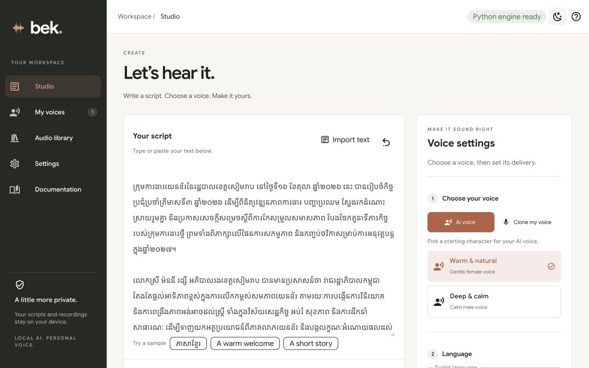
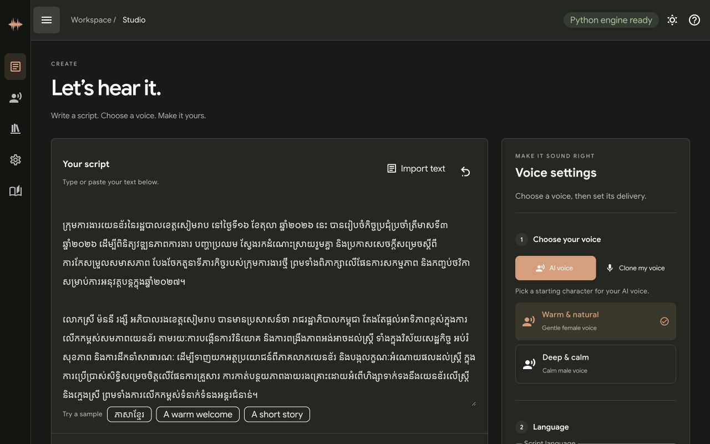
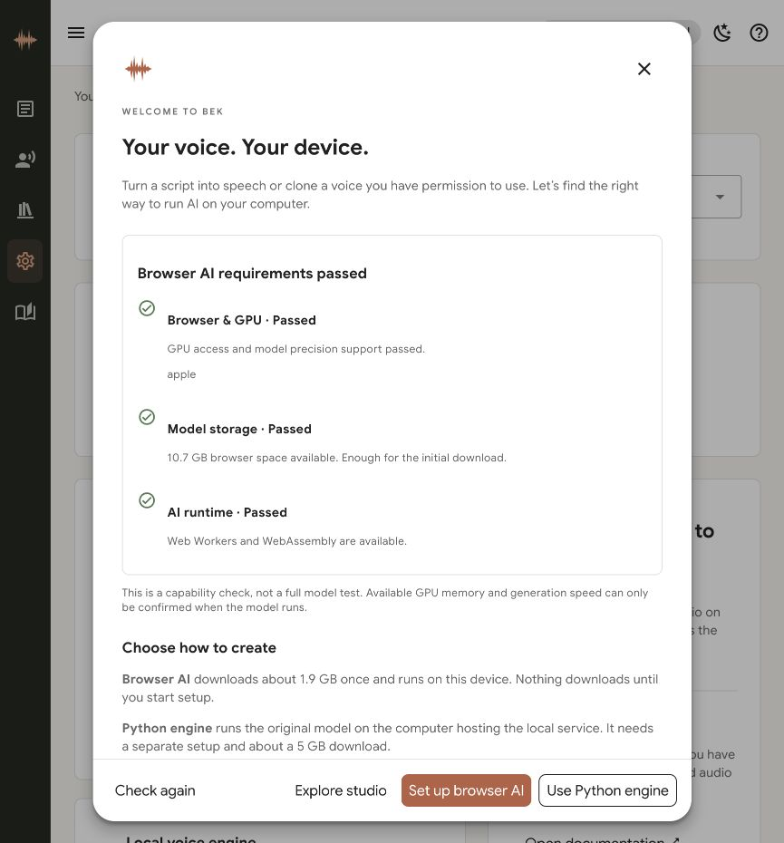
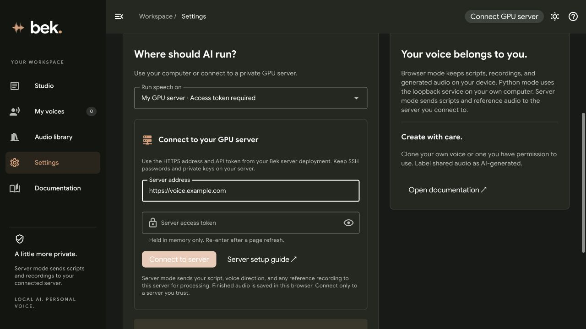

# Bek — Local voice studio

Text to speech, voice design, permission-based voice cloning, WAV export, estimated SRT, browser-local voice/audio libraries, and an optional authenticated GPU server.

## Screenshots

### Studio · Light theme

Write your script and choose a voice, language, and delivery in one workspace.



### Studio · Dark theme with compact navigation

Collapse the sidebar with the top-left menu button to give your script more room. Your navigation preference is saved on this device.



## First-run device check

Bek opens a welcome dialog on your first visit. It checks HTTPS/localhost access, WebGPU and shader-f16 GPU access, Web Workers/WebAssembly, and estimated browser storage. Browser setup needs about 1.9 GB to download and at least 2.2 GB available storage. The check itself downloads no model and requests no microphone access.

If browser AI is unavailable, choose **Use Python engine** for setup instructions, or **Explore studio** to continue. You can reopen the dialog from **Settings → Device compatibility → Run device check**. Passing the check confirms browser capabilities, not available GPU memory or generation speed; loading and running the model is the final test. Storage estimates may be unavailable or change over time.



## In-app documentation

Open **Documentation** in the sidebar (Docs on mobile), or click the help icon. The guide includes searchable topics, copyable setup commands, and direct links such as `#docs/python`, `#docs/docker`, and `#docs/troubleshooting`. It is bundled with the app and supports light/dark themes.

## Frontend development (Vue + Vuetify)

The frontend uses **Vue 3, Vuetify 4, and Vite** with local Google Sans fonts. Install **Node.js 22.12+** for development or the local launch scripts. Docker builds the frontend automatically; Node is not required on the Docker host.

```sh
npm ci
npm run dev
```

Open the local URL printed by Vite. Browser inference runs in that page. The development server proxies `/api` to `http://127.0.0.1:8765` for the optional Python service; start it separately with `./start-python.sh` when testing Python inference.

```sh
npm test            # Recording, queue, splitting, merging, and browser-adapter tests
npm run build       # Compile the static frontend into dist/
npm run preview     # Preview the production build (browser engine only)
```

- `src/App.vue`: Vuetify layout, navigation, and theme integration.
- `src/components/`: studio, voice settings/recording, audio results, libraries, settings, and documentation.
- `src/composables/`: reactive generation state, preferences, routing, and object-URL lifecycle.
- `src/services/`: browser engine, microphone capture, and IndexedDB persistence.
- `src/lib/`: text splitting, sequential generation, WAV assembly, and audio utilities.
- `src/data/guide.json`: bundled documentation content.
- `public/`: unchanged inference worker/manifest, ONNX Runtime, and local fonts.

`dist/` is generated and ignored by Git. Both local launch scripts install the locked frontend dependencies and build it before serving. Existing `sori-studio` IndexedDB and model-cache namespaces are retained. Use the same browser, hostname, and port to keep access to old saved work.

## Quick start with Docker Compose

Install Docker Desktop on Windows/macOS, or Docker Engine and the Compose plugin on Linux. Clone using HTTPS (your friends do not need your SSH alias):

```sh
git clone https://github.com/virakbuthchhan/bek-voice.git
cd bek-voice
docker compose up -d --build
```

Open **http://localhost:8765** in Chrome or Edge. Click **Set up · ≈1.9 GB download**, wait for the model to be ready, then generate speech or clone a permitted voice.

The container serves the app. **AI generation uses each visitor's browser GPU**, so no GPU, Python speech dependencies, API key, or model download is needed on the Docker host. Windows/macOS/Linux hosts and ARM64/AMD64 images are supported by the base image; visitors still need a compatible browser and GPU. Model files, voices, and audio history stay in that visitor's browser. Container restarts do not erase browser data.

The default port is bound only to the host's loopback interface. To change it, copy `.env.example` to `.env` and set `PORT=8876`, then run the same command. Access the app using a consistent hostname and port: browser storage is separate for every origin, including `localhost` versus `127.0.0.1`.

```sh
docker compose ps                 # Container and health status
docker compose logs -f           # Logs
docker compose down              # Stop and remove the container
git pull
docker compose up -d --build     # Apply an update
```

Use the modern `docker compose` plugin. The retired Python-based `docker-compose` v1 command is not required.

### Docker without Compose

```sh
docker build -t bek-voice .
docker run -d --name bek-voice --restart unless-stopped -p 127.0.0.1:8765:8080 bek-voice
```

## Generate on your own GPU VPS

Choose where AI runs in **Settings → Run speech on**:

| Option | AI runs on | Connection |
| --- | --- | --- |
| This browser | The visitor’s WebGPU device | No credentials; one-time ≈1.9 GB browser model |
| This computer · Python | The computer running `./start-python.sh` | Loopback-only local service; ≈5 GB model |
| My GPU server | Your own VPS | HTTPS server address + API access token; ≈5 GB model on VPS |

The server option also supports Full voice, Split voice, reference-voice cloning, part playback/downloads, and merging. **Server mode sends scripts, voice directions, and reference recordings to your server.** Completed audio and your library are stored in the browser. The built-in API does not persist scripts or generated audio; temporary reference files are deleted after each request. Your hosting provider or any custom proxy logging may have its own retention behavior.



### Deploy the authenticated GPU stack

The included GPU configuration targets **Linux x86_64 with an NVIDIA GPU and CUDA 12.8-compatible drivers**. Install Docker Engine, Compose, the NVIDIA driver, and the [NVIDIA Container Toolkit](https://docs.nvidia.com/datacenter/cloud-native/container-toolkit/latest/install-guide.html). Follow [Docker’s GPU reservation guide](https://docs.docker.com/compose/how-tos/gpu-support/) to confirm containers can access the GPU. AMD/ROCm and ARM GPU servers need a matching image and device configuration; this CUDA stack does not configure them.

1. Clone this repository on the VPS. Point your domain to it, allow ports 80/443, and ensure no other service already occupies those ports.
2. Copy `.env.example` to `.env`, generate a token using `openssl rand -hex 32`, and set:

```dotenv
DOMAIN=voice.your-domain.com
ACME_EMAIL=you@example.com
BEK_API_TOKEN=replace-with-your-generated-token
BEK_ALLOWED_ORIGINS=https://voice.your-domain.com,http://127.0.0.1:8765,http://localhost:8765
```

`BEK_ALLOWED_ORIGINS` is a comma-separated list of exact **app origins** that may connect, with no trailing slash or wildcard. Add the real HTTPS origin if you host the frontend separately. Localhost entries let your locally running app connect to the VPS. Remove origins you do not use. CORS is an origin restriction; the access token authenticates every API request, including command-line requests without an Origin header.

3. Start this **standalone** Compose file; do not combine it with `compose.yaml` or `compose.vps.yaml`:

```sh
docker compose -f compose.gpu.yaml up -d --build
docker compose -f compose.gpu.yaml ps
docker compose -f compose.gpu.yaml logs -f inference
```

The CUDA image and Python dependencies are large. The `inference` service runs as a non-root user, uses one NVIDIA GPU, and keeps downloaded model files in the `model_cache` volume. The API has no published port; Caddy exposes it through HTTPS at `/api/*`, and serves the frontend on the same domain. The API starts without loading weights. The health check confirms HTTP availability, not model readiness. The frontend’s connection check reads the authenticated model status.

4. Open the app, choose **My GPU server**, enter `https://voice.your-domain.com` and your API token, then click **Connect to server**. Click **Load server model** once and wait for Ready before generating.

The token is sent as an Authorization Bearer header, never in the URL. The app keeps it **in memory only**, clears the password field after connecting, and requires it again after refreshing. Only the server address and engine choice are saved. Do not enter SSH passwords, private keys, or root credentials into the app. The app’s API token grants generation/model-loading access to anyone who holds it; use this stack for your own users, rather than as an anonymous public service.

To revoke access, replace `BEK_API_TOKEN` in the VPS `.env` and recreate the API service:

```sh
docker compose -f compose.gpu.yaml up -d --force-recreate inference
```

Existing clients must reconnect with the new token. Never commit `.env`. Stopping with `down` preserves cached weights; `down -v` removes the model and certificate volumes.

The API runs one model operation at a time. Another client receives a busy response and can retry; this is not a multi-user job scheduler. With Split voice, completed parts remain available if a later part fails, and you can continue while the page and original server connection remain open. Disconnecting or updating the server connection clears the unfinished-run continuation credentials. HTTP transport failures can leave the server finishing its current request; check status before retrying.

### Server troubleshooting

- **Token rejected:** confirm `.env` and the app use the same API token (32–512 printable ASCII characters with no whitespace); recreate `inference` after changing it.
- **Cannot connect / origin blocked:** confirm valid HTTPS, DNS, Caddy status, and that your exact app origin is listed. Redirects are refused so tokens cannot follow another endpoint. Enter just the server origin, without `/api` or a path.
- **GPU unavailable / load fails:** check `nvidia-smi` and NVIDIA container support on the VPS, then inspect inference logs. The available GPU memory and actual model run must be verified on your hardware.
- **Another generation is running:** wait for the current server request, then retry. Split mode keeps completed parts.
- **Local Python from a hosted app:** browser AI works directly. For native local Python, open the app from `./start-python.sh` on your computer; the hosted site does not connect to an unauthenticated local Python API.

The GPU base uses PyTorch 2.8/CUDA 12.8, matched torchaudio, and a [compatible TorchCodec version](https://github.com/meta-pytorch/torchcodec#compatibility-with-torch-versions). Model files download only when an authenticated user requests model loading.

## Deploy browser-only hosting on a VPS with HTTPS

The VPS serves the same browser app; voice processing still runs on visitors' computers. The included production stack uses Caddy for automatic HTTPS and stores certificates in named Docker volumes.

1. Install Docker Engine and the Compose plugin on the VPS.
2. Point your domain's DNS A record to the VPS IPv4 address. Only add an AAAA record if IPv6 is also routed to that VPS. Allow inbound TCP ports **80 and 443**; UDP 443 is optional for HTTP/3. Keep SSH access available.
3. Clone the repository and configure your real domain and certificate contact email:

```sh
git clone https://github.com/virakbuthchhan/bek-voice.git
cd bek-voice
cp .env.example .env
# Edit .env:
# DOMAIN=voice.your-domain.com
# ACME_EMAIL=you@your-domain.com
```

4. Start the standalone VPS configuration:

```sh
docker compose -f compose.vps.yaml up -d --build
docker compose -f compose.vps.yaml logs -f caddy
```

Open **https://voice.your-domain.com** after DNS resolves and Caddy obtains a certificate. Use the same `-f compose.vps.yaml` argument for `ps`, `logs`, `down`, and future updates. Do not combine the local and VPS Compose files. Port 8080 stays internal to the VPS Docker network; only Caddy publishes ports.

**HTTPS is required for browser WebGPU on remote hosts.** An `http://VPS_IP:8765` or plain HTTP LAN address is not a working substitute for HTTPS. Localhost HTTP is suitable for local use. This requirement is documented by [WebGPU](https://developer.mozilla.org/en-US/docs/Web/API/WebGPU_API); certificate provisioning requirements are in [Caddy's HTTPS documentation](https://caddyserver.com/docs/automatic-https).

If another reverse proxy already owns ports 80/443, use `compose.yaml` to serve on VPS loopback and configure that proxy to terminate HTTPS and forward to `127.0.0.1:8765`. Ensure its response MIME types preserve JavaScript modules and `application/wasm`. Do not put the site in a cross-origin iframe that blocks WebGPU.

Model downloads go directly from Hugging Face to the visitor. Changing the domain or port starts a new browser-storage origin. The production stack is a static website, not a shared server-side inference service; the optional local Python engine below is not included in these containers.

### Troubleshooting

- **Port already in use:** change `PORT` in `.env` for local Compose. On a VPS, ensure Caddy can use 80/443 or use your existing HTTPS reverse proxy.
- **WebGPU unavailable:** open localhost or the HTTPS domain in a current Chrome/Edge desktop browser, enable hardware acceleration, and check GPU/shader-f16 support.
- **Model download/storage errors:** keep at least 2.2 GB of browser site-storage capacity available and allow downloads from Hugging Face. Resume setup; completed segments are reused.
- **New version not visible:** refresh the page. If necessary, close/reopen the app. Clearing site data also removes model and voice caches, so reserve that for a full reset.
- **VPS certificate not issued:** check DNS (including AAAA records), reachability on 80/443, and Caddy logs. The certificate volumes must remain writable. `down -v` deletes certificate volumes; normal `down` preserves them.

## Browser mode: one-time ≈1.9 GB download

Build with `npm ci && npm run build`, then serve `dist/` with a static HTTP server or publish it to an HTTPS host. Alternatively, the local script installs dependencies and builds automatically:

```sh
./start.sh
```

Open http://127.0.0.1:8765 in a current Chrome or Edge desktop browser with WebGPU and shader-f16 support.

1. Under **Local voice engine**, click **Set up · ≈1.9 GB download**.
2. Wait for the progress bar and GPU preparation to finish.
3. Enter text, select a voice direction, or upload/record a 3–30 second reference and confirm permission to clone it.
4. Click **Generate speech**. Listen or download WAV and estimated SRT.

Model files total **1.94 GB** (decimal GB). The app also bundles about 42 MB of ONNX Runtime assets. Model data is cached in browser storage with segmented download resumption and integrity checks. After a page reload, click **Load saved model** to load it back into GPU memory. Setup can be cancelled and resumed. Clearing site data or browser eviction removes cached files. A browser with at least 2.2 GB free site-storage capacity is required. GPU compatibility and available memory vary by device.

Scripts and references stay inside the browser during browser inference. Only model files are downloaded from Hugging Face. No voice API or API key is used. Fonts and runtime files are bundled locally. The app shell and used runtime assets are cached by a service worker for offline return visits. Browser cache eviction or clearing site data requires a fresh download.

## Record a reference voice in the browser

In **Voice settings → Clone my voice**, choose **Record**. Select the Khmer or English reading sample, then click **Start recording** and allow microphone access. Read in a quiet room using your natural voice; 10–20 seconds is a good target.

Click **Stop**, listen to the preview, then click **Use recording**. Give the voice a name, confirm permission, and generate speech or save it to **My voices**. You can record again or discard the take before using it. Uploading an existing WAV remains available.

- Recordings must contain at least 3 seconds of non-silent audio and stop automatically at 30 seconds.
- The browser converts recordings to mono WAV locally. They use the same cloning and voice-library flow as uploaded references.
- The microphone is requested only after clicking Start; its tracks are released on Stop, Cancel, leaving the recording flow, or leaving the page.
- HTTPS is required on remote deployments; localhost HTTP works for local use. If access is denied, update the site's microphone permission in your browser or upload a WAV instead.
- The reading passage is a prompt for the speaker, not an assumed transcript; cloning does not require reading it word for word.

## Appearance

Use the sun/moon button in the top bar to switch between light and dark themes. **Settings → Appearance** also offers **Use system theme**. The preference is saved on the device and applied before the page paints.

## Long scripts and audio parts

Choose **Full voice** for one generation request containing the whole script, or **Split voice** for short parts (up to about 200 characters). Split mode prefers paragraphs, sentences, and word boundaries; Khmer character clusters stay together. Both modes work with the browser and Python engines. Full mode can take longer before the first audio is available.

Voice settings follow three steps: choose an AI voice or clone your own (saved voice, upload, or browser recording), select the script language, then optionally adjust delivery and quality. Voice saving and advanced guidance/seed controls are collapsed by default.

- Watch the current part, elapsed time, and completed-part count while generation runs. Each part has a progress bar: animated while generating, full when ready, and empty while waiting. The engine does not expose a reliable percentage within a generation request, so no estimated percentage is shown.
- Play or download each finished part immediately, without waiting for the full script.
- **Stop after this part** finishes the current request and keeps completed audio. **Continue remaining parts** resumes the current run while the page stays open, using the original voice and settings.
- **Merge all parts** joins finished WAV audio in script order without re-generating or re-encoding samples. A stopped run can merge just its completed parts.
- Parts are saved in the audio library as they finish. Reopen a saved run to play/download its parts or merge them. Reloading preserves finished audio; continuing unfinished generation requires keeping the original page open.

## Optional Python engine

The original Python model remains available under **Settings → Run speech on → Local Python service**. Install Python 3.10–3.12 and Node.js 22.12+, then run:

```sh
./start-python.sh
```

Open http://127.0.0.1:8765, switch to Python mode, and click **Load Python model**. First setup downloads about 5 GB of original weights to `.models/`. Apple Silicon MPS, NVIDIA CUDA, or CPU is selected automatically. Use `SORI_DEVICE=cpu ./start-python.sh` if acceleration fails.

On Windows:

```powershell
npm ci
npm run build
py -3.12 -m venv .venv
.venv\Scripts\pip install -r local/requirements.txt
.venv\Scripts\python local/server.py
```

## Notes

- AI voice characters are voice descriptions, not fixed speaker identities.
- Language is detected by the model; the language menu adds a speaking direction.
- Full voice generates the whole script in one request; Split voice uses smaller chunks in either engine.
- SRT timing is estimated proportionally by sentence, not forced alignment.
- References and audio clips are saved in IndexedDB for this browser and origin. Download important audio before clearing site data.
- Only clone voices you own or have permission to use. Label shared audio as AI-generated.
- Sources and third-party attribution: see THIRD_PARTY.md.

## Checks

```sh
npm test
npm run build
python3 -m py_compile local/server.py
```

With the optional Python engine dependencies installed, run the backend regression checks (no model download needed):

```sh
.venv/bin/python scripts/test-python-engine.py
```

To check a running Docker deployment without downloading the model again:

```sh
python3 scripts/smoke-container.py http://localhost:8765
docker compose config --quiet
docker compose --env-file .env.example -f compose.vps.yaml config --quiet
```

The smoke check validates app assets, health, module/WASM content types, byte ranges, and deployment headers. It does not perform GPU inference or request public TLS certificates.
